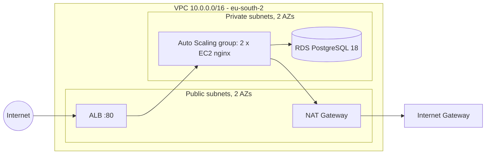

# aws-terraform-lab

A small AWS environment built with Terraform while learning:
a multi-AZ VPC, an Application Load Balancer, an Auto Scaling group of nginx
instances in private subnets, and a private PostgreSQL database on RDS.

It is a **lab**: it is designed to be created, tested and destroyed, not left running.

> **Cost warning:** the NAT Gateway, the ALB and the RDS instance are billed per hour
> while they exist. Run `terraform destroy` when you finish.

## Architecture



- **Network:** VPC, 2 public and 2 private subnets across 2 AZs, Internet Gateway,
  one NAT Gateway, separate route tables.
- **ALB:** internet-facing, HTTP :80, forwards to a target group.
- **Compute:** launch template (Ubuntu 24.04, IMDSv2 required) and an Auto Scaling
  group of 2 `t3.micro` instances in the private subnets. nginx is installed via `user_data`.
- **Database:** RDS PostgreSQL 18 (`db.t3.micro`, gp3, encrypted, not public).
  The master password is generated and stored in Secrets Manager.

## Usage

Requirements: Terraform >= 1.9, AWS credentials configured, region `eu-south-2`.

```bash
cd infra/envs/dev
terraform init
terraform plan
terraform apply
```

Check it works: open the `alb_info` DNS output in a browser or run `curl` on it
several times. The page shows the hostname and AZ of the instance that answered,
and it should alternate between the two instances.

```bash
terraform destroy
```

## Status

Deployed and verified: network, ALB, Auto Scaling group and RDS. Not tested yet:
connectivity from the instances to the database (the security group rules exist).

## Docs

[Design decisions](docs/decisions.md) · [Learning log](docs/learning-log.md)

## License

MIT